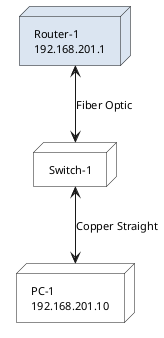

# ITERA Typst Lab Report Standard & Generation Guide

## Overview

This skill establishes the authoritative, zero-tolerance standard for authoring, editing, auditing, and compiling publication-grade lab reports for Informatics Engineering courses at Institut Teknologi Sumatera (ITERA). It covers the unified Typst architecture, strict typography rules, real host inspection, course-specific invariants (Jarkom, Basis Data, PBO), and multi-gate QA validation using the `laprak` CLI/TUI.

---

## The 4 Iron Laws of Grounding & Quality

```text
1. ZERO HALLUCINATION: All parameters, formulas, and topologies MUST be strictly grounded in the official lab module PDF and student metadata. Never invent subnetting formulas, modulo offsets, or fake SQL tables.
2. EMPIRICAL HOST INSPECTION: Specifications in tools-and-materials.typ MUST be inspected directly from the real host machine via terminal commands. Generic placeholder hardware data is strictly prohibited.
3. VISUAL & CLI AUTHENTICITY: Captions must match figure content. Verification figures MUST depict actual CLI outputs (e.g., ping replies, routing tables, query output, compiler logs)—never bare duplicate canvas diagrams.
4. PHYSICAL & MEDIA FIDELITY: Cable types (Fiber Optic vs Copper), interface statuses (up/up green links), and software versions must conform exactly to the module guidelines.
```

---

## Repository & Course Architecture

The repository manages multiple laboratory courses with unified configuration:

```text
Template Laprak/
├── profile.toml            # Master student profile (synced to each course)
├── pyproject.toml          # Tooling dependencies (lab-report CLI)
├── tools/lab_report/       # Unified CLI/TUI compiler, tester, & packer
├── database/               # Database Systems (ISO B5, Garamond)
├── computer-networks/      # Computer Networks (ISO B5, Garamond)
├── object-oriented-programming/ # Object-Oriented Programming (A4, Times New Roman)
└── DRPL/                   # Software Engineering / System Design
```

### Modular Typst File Structure (computer-networks & database)


```text
<Course>/
├── main.typ                # Document entry point (only imports & config)
├── data/
│   ├── report.typ          # Module title, session, date, and cover banners
│   ├── student.typ         # Student Name & NIM (auto-synced from profile.toml)
│   ├── class.typ           # Class group (RA/RB/RC)
│   ├── assistants.typ      # List of teaching assistants
│   └── members.typ         # Group members (or empty () for individual reports)
├── content/
│   ├── summary.typ         # Ringkasan Praktikum (Summary callout box)
│   ├── tools-and-materials.typ # Empirical host hardware & software table
│   ├── documentation.typ   # Master documentation file including step-*.typ
│   ├── documentation/      # Step-by-step modular files (step-1.typ, step-2.typ, ...)
│   ├── tasks.typ           # Post-lab tasks and technical analysis
│   └── references.typ      # Bibliography with hanging indent
├── template/
│   ├── lib.typ             # Master page setup, geometry, headings, typography
│   ├── cover.typ           # Page 1: Outer cover banner
│   ├── inner-title.typ     # Page 2: Inner title with adaptive stack
│   └── components.typ      # summary-box, step-figure, topic, references-list
└── assets/                 # Tightly cropped figures and diagrams
```

---

## Strict Typography & Formatting Invariants

### 1. Uniform 1.5 Line Spacing (No Extra Paragraph Gaps)
In `lib.typ`, paragraph and list spacing is calibrated to emulate standard Word 1.5 line spacing:
```typst
set par(
  justify: true,
  leading: 0.75em,
  spacing: 0.75em,
  first-line-indent: 0pt
)

set list(
  marker: ([•], [–]),
  indent: 0pt,
  body-indent: 6pt,
  spacing: 0.75em
)

set enum(
  indent: 0pt,
  body-indent: 6pt,
  spacing: 0.75em
)
```
- **Invariant:** Consecutive body paragraphs must be separated by a single newline. **Never** insert manual `#v(...)` spacers or double empty lines between body paragraphs.

### 2. Prohibition of Colons on Bold Titles
In all documentation steps, bullet lists, and task breakdowns, bold title headers must NEVER have a trailing colon (`:`).
- ✅ **CORRECT:**
  ```typst
  *Konfigurasi Antarmuka GigabitEthernet0/0* \
  Penjelasan konfigurasi alamat IP dan pengaktifan antarmuka...
  ```
- ❌ **STRICTLY FORBIDDEN:**
  ```typst
  *Konfigurasi Antarmuka GigabitEthernet0/0:* Penjelasan konfigurasi...
  *Konfigurasi Antarmuka GigabitEthernet0/0*: Penjelasan konfigurasi...
  ```

### 3. Two-Line Item Format & Native Hanging Indent
When detailing operational steps, each item must be formatted across two lines:
1. Line 1: Bold title followed by a forced line break `\`.
2. Line 2: The descriptive explanation.

Using Typst's native numbered list (`+`) ensures a **hanging indent**, where wrapped lines align flush under the text after the number, NOT under the number:
```typst
#set enum(numbering: "1.")
+ *Topologi Fisik Jaringan* \
  Pemasangan perangkat router, switch, dan end device pada area kerja simulator dengan interkoneksi kabel fiber optik sesuai panduan modul.

+ *Konfigurasi Pengalamatan IP* \
  Pemberian alamat IP statis pada seluruh antarmuka host dan gerbang default jaringan sesuai alokasi subnet berbasis NIM.
```

For alphabetical task items:
```typst
#set enum(numbering: "A.")
+ *Analisis Peran Protokol ARP* \
  Penjelasan detail mengenai terjadinya latensi atau Request Time Out (RTO) pada transmisi paket ICMP perdana akibat proses broadcast resolusi MAC address.
```

### 4. Zero Placeholder Anomaly Text
- **Never** leave template instruction text in the generated report (e.g. `Jelaskan Langkah-langkah yang dilakukan selama praktikum` or `[Tuliskan deskripsi di sini]`).
- Any placeholder text must be replaced with rigorous technical content or removed entirely.

### 5. Adaptive Cover & Inner Title Stacks
- **Outer Cover (`cover.typ`)**
  - Banner \
    `Bernard MT`, `size: 22pt`, `fill: rgb("595959")`, `par(leading: 0.65em, justify: false)`.
  - Leading `0.65em` ensures airy line spacing (~31–33px) preventing line collisions.
- **Inner Title (`inner-title.typ`)**
  - Font \
    `Arial`, weight 900, `size: 23.5pt`, `fill: rgb("959595")`, `par(leading: 0.55em)`.
  - The title and horizontal separator rule ($357.48\text{ pt}$) MUST be wrapped inside a dynamic `#stack`:
    ```typst
    #stack(
      spacing: 18pt,
      [
        #set text(font: "Arial", weight: 900, size: 23.5pt, fill: rgb("959595"))
        #set par(leading: 0.55em)
        #title
      ],
      line(length: 357.48pt, stroke: 1.25pt + rgb("959595"))
    )
    ```
  - This eliminates phantom blank line spacing when titles span 1, 2, or 3 lines.

### 6. Table & Figure Constraints
- **Table Width:** Total column width must be $\le 125\text{ mm}$ (B5 textwidth is $125.2\text{ mm}$).
- **Table Colors:** Header `#tabhead` (`#4F81BD`), zebra band `#tabband` (`#DBE5F1`), line border `#tabline` (`#95B3D7`).
- **Figure Insertion:**
  ```typst
  #step-figure(
    image("../../assets/step-1-topology.png", width: 100%),
    caption: [Topologi Interkoneksi Router Multi-Area OSPF]
  )
  ```
- **Screenshot Bounding Box:** All screenshots must be tightly cropped:
  ```bash
  magick convert input.png -trim +repage -bordercolor white -border 25 output.png
  ```

---

## Empirical Host System Audit

Before authoring `content/tools-and-materials.typ`, you MUST execute the following terminal inspection commands to capture the real machine specs:

```bash
# 1. CPU & Architecture
lscpu | grep "Model name:" | sed -e 's/Model name:[[:space:]]*//'

# 2. Total System RAM
free -h | awk '/^Mem:/ {print $2}'

# 3. Storage & Primary Drive
lsblk -d -o NAME,MODEL,SIZE | grep -E "nvme|sda"

# 4. OS Distribution & Kernel
cat /etc/os-release | grep "PRETTY_NAME" | cut -d= -f2 | tr -d '"'
uname -r

# 5. Typst Compiler Version
typst --version

# 6. Simulator / Course Environment
cat ~/.local/bin/packettracer 2>/dev/null || which packettracer || echo "Native/Distrobox"
```

Fill `content/tools-and-materials.typ` with the real output:
```typst
#let tools-data = (
  ("1", "Prosesor (CPU)", "AMD Ryzen 7 5800H with Radeon Graphics (16 vCPU)"),
  ("2", "Memori (RAM)", "16 GB DDR4 Dual-Channel"),
  ("3", "Penyimpanan", "512 GB NVMe SSD"),
  ("4", "Sistem Operasi", "Linux Fedora 41 (Kernel 6.11)"),
  ("5", "Simulator Jaringan", "Cisco Packet Tracer v8.2.1"),
  ("6", "Document Engine", "Typst v0.13.0"),
)
```

---

## CLI & TUI Execution Reference

Always run commands via `uv run` from the repository root:

```bash
# 1. Interactive Terminal UI
uv run lab-report

# 2. Build PDF report
uv run lab-report build computer-networks -m 5
uv run lab-report build database -m 3
uv run lab-report build object-oriented-programming -m 2

# 3. Live Watch mode (recompiles on file change)
uv run lab-report watch computer-networks -m 5

# 4. Deterministic Linter (Typography & Quality Invariants)
uv run lab-report lint computer-networks
uv run lab-report lint database --fix

# 5. Automated Host Hardware Inspection (Populates tools-and-materials.typ)
uv run lab-report inspect computer-networks --write
uv run lab-report inspect --json

# 6. Pure Vector SVG Diagram Generator (PlantUML to SVG)
uv run lab-report render computer-networks
uv run lab-report render -p computer-networks/assets/diagrams/topologi-ospf.puml

# 7. Run automated test suites (declarative geometry & SVG vector regression)
uv run lab-report test computer-networks
uv run lab-report test database
uv run lab-report test object-oriented-programming

# 8. Package submission archive (ZIP)
uv run lab-report pack computer-networks -m 5
uv run lab-report pack object-oriented-programming -m 2

# 9. Launch Native Model Context Protocol (MCP) Server for AI Agents
uv run lab-report mcp

# 10. Inspect or update student profile
uv run lab-report profile --show
uv run lab-report profile --name "Jane Smith" --nim "xxxxxxxxx" --class "RX"
```
*(Note: `uv run laprak ...` remains supported as a backwards-compatible alias).*

---

## PlantUML Pure Vector SVG Generator (Zero Raster)

For topology diagrams (Jarkom), Entity-Relationship Models (Basis Data), and UML Class hierarchies (PBO), **never commit raster images (.png/.jpg) for diagrams**. Store source files as `.puml` under `<Course>/assets/diagrams/*.puml` and compile them to vector `.svg`:



Compile directly via:
```bash
uv run laprak render jarkom
```
And insert in Typst via:
```typst
#step-figure(image("../assets/diagrams/topologi-ospf.svg", width: 100%), [Topologi Multi-Area OSPF])
```

---

## Model Context Protocol (MCP) Server Integration

The repository provides a built-in MCP server (`lab-report-mcp`) accessible over standard I/O (`uv run lab-report mcp`), configured in `.agents/mcp_config.json`. AI agents can directly invoke:
- `lab_report_inspect_host(course, write_file)` \
  Automatically captures CPU, RAM, OS, Typst specs and updates `content/tools-and-materials.typ`.
- `lab_report_lint(course, fix)` \
  Audits typography rules (colon on bold headers, template placeholders).
- `lab_report_render_diagram(puml_path, out_dir)` \
  Compiles PlantUML diagrams into SVG.
- `lab_report_build(course, module, format)` \
  Compiles reports to PDF or SVG.
- `lab_report_verify(course)` \
  Executes geometric anchor verification and SVG vector diff.
- `lab_report_pack(course, module)` \
  Bundles submission archive.
- `lab_report_profile(action, name, nim, student_class)` \
  Manages student profile.
*(Note: `laprak_*` tool names remain available as backwards-compatible aliases).*

---

## Course-Specific Technical Invariants

### 1. Computer Networks (`IF25-21008`)
- **Title Conventions** \
  Must use En-dash `–`: `Simulasi Cisco – <Judul Modul>`.
- **NIM Subnetting Rules**
  - Base subnet formula from module \
    e.g. `192.168.NIM.0/24`. If NIM is `xxxxxxxxx`, last digits give `192.168.xxxxxxx.xx/24` or as prescribed.
  - **Never** invent artificial modulo or multiplier equations unless stated verbatim in the module PDF.
- **Wildcard Mask Calculation** \
  $$\text{Wildcard Mask} = 255.255.255.255 - \text{Subnet Mask}$$
  - For `/24` ($255.255.255.0$) \
    Wildcard is $0.0.0.255$.
  - For `/30` ($255.255.255.252$) \
    Wildcard is $0.0.0.3$.
- **Cables & Media**
  - Orange solid line = Fiber Optic. Must connect to optical ports (`FastEthernet4/0` or optical interface card).
  - Dashed black line = Copper Cross-over. Solid black line = Copper Straight-through.
  - Match cable types to module diagrams 100%.
- **Port Link Invariant**
  - All connected interfaces must execute `no shutdown` at both endpoints.
  - Screenshots displaying red or amber link lights are strictly rejected.
- **Verification Proofs**
  - Screenshots must display real CLI output: `ping` with `Reply from ...`, `show ip route`, or `show ip dhcp binding`.
  - Topology-only images do NOT qualify as verification proofs.

### 2. Database Systems (`IF22-21010`)
- **Course Code & Format** \
  `IF22-21010 BASIS DATA`, ISO B5, Garamond 12pt.
- **SQL Scripts & Code Blocks**
  - DDL (`CREATE TABLE`, `ALTER TABLE`) and DML (`INSERT`, `SELECT`, `UPDATE`) must be styled with full syntax highlighting using Typst raw blocks.
- **Relational Integrity**
  - Document Primary Keys, Foreign Keys, `ON DELETE CASCADE`, and indexing strategies clearly.
- **Verification Proofs**
  - Screenshots must capture actual DBMS CLI or GUI (pgAdmin, DBeaver, MySQL CLI) results showing row count, returned records, and execution time.

### 3. Object-Oriented Programming (`IF22-20008`)
- **Format** \
  ISO A4 (210mm x 297mm), Times New Roman 12pt, 72pt margins, single cover page (`make-cover`).
- **Java Sources**
  - Place all `.java` code files in `object-oriented-programming/src/*.java`.
  - When packaging via `uv run lab-report pack object-oriented-programming -m <X>`, the packer places all Java files from `object-oriented-programming/src/` directly at the root of the `.zip` archive alongside the PDF.
- **Verification Proofs**
  - Capture real terminal compilation (`javac`) and program runtime execution (`java`) showing console outputs.

---

## 4-Gate Quality Assurance Verification Protocol

Before declaring any report complete, execute this 4-gate QA pipeline:

```text
[Gate 1: Parameter & Formula Audit]
         │
         ▼
[Gate 2: Empirical Host System Inspection]
         │
         ▼
[Gate 3: Compilation & Geometry Verification (verify-geometry.py)]
         │
         ▼
[Gate 4: SVG Vector Regression Inspection (diff-pages.py)]
```

### Gate 1: Parameter & Formula Audit
- Extract module PDF instructions via `pdftotext`.
- Verify student NIM substitution in all IP subnets, database schemas, and Java package names.

### Gate 2: Empirical Host Inspection Check
- Run terminal checks (`lscpu`, `free`, `uname`). Confirm `tools-and-materials.typ` matches the physical host.

### Gate 3: Compilation & Coordinate Geometry Verification
- Run:
  ```bash
  uv run laprak test <course>
  ```
  Or directly:
  ```bash
  python tests/verify-geometry.py
  ```
- **Pass Threshold:** All 27 layout anchors (margins, banner bounds, inner title rules, running headers/footers) must match reference baselines within a tolerance of $\le 0.5\text{ pt}$.

### Gate 4: Visual & SVG Vector Regression Inspection
- Render pages to SVG:
  ```bash
  typst compile --font-path fonts main.typ output_svg/{n}.svg
  ```
- Run vector diff:
  ```bash
  python tests/diff-pages.py
  ```
- **Pass Threshold:** 0 layout shifts, 0 text overflows, 0 red link-down ports, 0 placeholder anomalies.

---

## Rationalization Table & Red Flags

| Rationalization / Excuse | Reality & Absolute Rule |
| :--- | :--- |
| *"Using generic hardware specs (Intel i7, 16GB) is fine for a template."* | **FORBIDDEN.** Evaluators inspect system authenticity. Run `lscpu` and `free` on the host machine. |
| *"I'll add a colon after bold text like `*Langkah 1:*` to look clean."* | **FORBIDDEN.** Colons after bold titles violate the repository typography standard. Use `*Langkah 1* \ \n isi`. |
| *"Empty paragraph spacing (12pt gap) makes it easier to read."* | **FORBIDDEN.** The standard is Word 1.5 line spacing (`0.75em`) with NO extra paragraph gaps. |
| *"A topology screenshot is enough proof that routing works."* | **FORBIDDEN.** Proof requires CLI output (`Reply from...`, `show ip route`). |
| *"Leaving the instruction text 'Jelaskan langkah-langkah...' helps guide the reader."* | **FORBIDDEN.** Instruction text is template placeholder slop and must be deleted. |
| *"I don't need to recompile the PDF after editing .typ files."* | **FORBIDDEN.** Always compile and test (`uv run laprak build <course>`) after any change. |

### Red Flags - STOP and Fix Immediately:
- Any occurrence of `*Judul:*` in step or task files.
- Extra blank lines or `#v(...)` spacers between body paragraphs.
- Subnet addresses that do not match the student's NIM.
- Cisco Packet Tracer screenshots with red/amber interface LEDs.
- Hardware specifications that do not match terminal `lscpu`/`free` readings.
- Return code $\ne 0$ from `uv run laprak build` or test failures from `uv run laprak test`.
