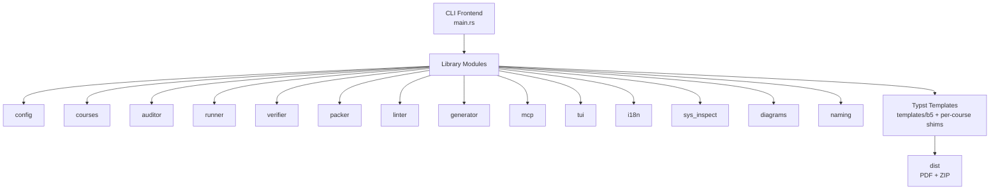
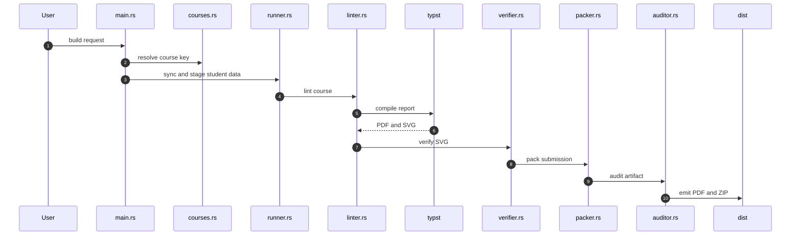

# System Architecture & Technical Topology

This document details the architectural topology, module boundaries, data lifelines, and quality guarantees of the ITERA Lab Report Template & Tooling ecosystem.

---

<!-- @gov:ARCH-OVERVIEW -->



## 1. Physical-to-Logical Topology Map

<!-- @gov:ARCH-TOPOLOGY -->

```text
Root Directory
├── database/                         # Domain: Database Systems Laboratory
│   ├── content/                      # Content: Chapters, DDL/DML, steps, and tasks
│   ├── data/                         # State: Student profile, assistants, and report metadata
│   └── template/                     # Layout: ISO B5 Typst library (Garamond 12pt)
│
├── computer-networks/                # Domain: Computer Networks Laboratory
│   ├── assets/diagrams/              # Assets: PlantUML sources (.puml) & vector outputs (.svg)
│   ├── content/                      # Content: OSPF/RIP routing steps, ARP analysis
│   ├── data/                         # State: NIM subnetting and report parameters
│   └── template/                     # Layout: ISO B5 Typst library with Cisco standards
│
├── object-oriented-programming/      # Domain: Object-Oriented Programming Laboratory
│   ├── content/                      # Content: Objective, analysis, and execution logs
│   ├── data/                         # State: Indonesian metadata format
│   ├── src/                          # Sources: Java source files (.java) packaged with report
│   └── template/                     # Layout: ISO A4 Typst library (Times New Roman 12pt)
│
├── crates/lab-report/                # Native: Standalone Rust Toolchain
│   ├── src/config.rs                 # Parsing: profile.toml loader & validator (FR-CLI-01)
│   ├── src/courses.rs                # Registry: Course specifications & aliasing (FR-CLI-02, FR-CLI-13)
│   ├── src/naming.rs                 # Formatter: Artifact filename generator (FR-CLI-03)
│   ├── src/runner.rs                 # Runner: Typst compiler & class.typ syncer (FR-CLI-04)
│   ├── src/packer.rs                 # Bundler: Zip archive packager (FR-CLI-05)
│   ├── src/linter.rs                 # Quality Gate: Typography & placeholder linter (FR-CLI-06)
│   ├── src/sys_inspect.rs            # Grounding: Empirical hardware probe (FR-CLI-07)
│   ├── src/diagrams.rs               # Compiler: PlantUML pure vector SVG generator (FR-CLI-08)
│   ├── src/generator.rs              # Scaffolding: Dual-mode project scaffolder (FR-CLI-09)
│   ├── src/verifier.rs               # Declarative: quick-xml zero-tolerance SVG audit (FR-CLI-10)
│   ├── src/mcp.rs                    # Integration: Native JSON-RPC 2.0 stdio MCP server (FR-CLI-11)
│   ├── src/i18n.rs                   # Internationalization: bilingual message catalog (FR-CLI-19)
│   └── src/tui.rs                    # TUI: Interactive init wizard & TUI loop (FR-CLI-12)
├── tests/                            # Quality Assurance: Automated Pytest Unit Test Suite
├── .agents/                          # Customizations: Workspace skills & MCP server definitions
├── AGENTS.md                         # Rules: Absolute invariants enforced on all AI pair programming
├── profile.toml                      # Master Configuration: Centralized student data
└── pyproject.toml                    # Environment: Dependencies & strict Ruff linter configuration
```


<!-- @gov:ARCH-BINDING -->

### Formal Specification Alignment

Functional requirements FR-CLI-01..19: docs/PRD.md.
Test-driven design contracts: docs/TDD.md.
Migration record (Python lab_report CLI to native Rust lab-report): docs/adr/0001-migrate-python-lab-report-cli-to-rust.md.

---

<!-- @gov:ARCH-INVARIANTS -->

## 2. Architectural Boundary Invariants

To maintain long-term architectural stability, the following cross-module boundary invariants are strictly enforced:

1. **Zero Shell Script Invariant**
   - No `.sh`, `.bat`, or `.cmd` scripts exist in the repository.
   - Course directories (`database/`, `computer-networks/`, `object-oriented-programming/`) provide standalone `build.py` running exclusively on Python standard library and Typst CLI.
2. **Standalone Project Purity**
   - Any project generated via `lab-report new --standalone` must run both `build.py` and `verify.py` without requiring any external `pip` packages.
3. **One-Way State Propagation**
   - Global student data originates in `profile.toml`.
   - Native `lab-report` CLI (`crates/lab-report`) propagates changes unidirectionally to `<course>/data/student.typ` and `class.typ`. Course files must never overwrite `profile.toml` automatically.
4. **Pure Vector Diagram Integrity (Zero Raster)**
   - Technical diagrams must be stored as source definitions (`.puml`) in `<course>/assets/diagrams/`.
   - Compiled diagrams must be pure vector `.svg`. Committing raster formats (`.png`, `.jpg`) for diagrams is strictly prohibited.
5. **Tool Isolation**
   - Toolchain logic is encapsulated within standalone native Rust workspace `crates/lab-report`, keeping course templates completely decoupled.

6. **FR-CLI-18 Release CI Removal**
   - FR-CLI-18 release CI is intentionally removed; distribution artifacts are produced by explicit local commands.

---

## 3. Data Lifeline: Compilation & Verification Flow

<!-- @gov:ARCH-LIFELINE -->



```text
[User / CLI / MCP Request]
           │
           ▼
[main.rs::main] ──(Resolves course via courses.rs::resolve_course_key / detect_course_from_path)
           │
           ▼
[runner.rs::sync_student_data] ──(Synchronizes profile.toml -> course/data/*.typ)
           │
           ▼
[linter.rs::lint_course_with_options] ──(Verifies typography invariants & zero placeholders)
           │
           ├── (Pass)
           ▼
[runner.rs::compile_report] ──(Invokes `typst compile --font-path fonts main.typ`)
           │
           ▼
[dist/<name>_<nim>_TugasN.pdf / output_svg/page-{0p}.svg]
           │
           ▼
[verifier.rs::verify_course] ──(Declarative quick-xml SVG audit, zero tolerance)
           │
           ▼
[packer.rs::pack_submission] ──(Bundles PDF + sources -> Submission ZIP)
```

---

## 4. Model Context Protocol (MCP) Interface

The repository exposes a native JSON-RPC 2.0 stdio server (`lab-report mcp`) allowing AI agents to interface with the codebase programmatically:
* `lab_report_inspect_host` $\rightarrow$ Host profiling (`sys_inspect`).
* `lab_report_lint` $\rightarrow$ Typography & placeholder audit (`linter`).
* `lab_report_render_diagram` $\rightarrow$ PlantUML to pure vector SVG (`diagrams`).
* `lab_report_build` $\rightarrow$ Typst PDF/SVG compilation (`runner`).
* `lab_report_verify` $\rightarrow$ Declarative SVG geometric audit (`verifier`).
* `lab_report_pack` $\rightarrow$ Submission ZIP bundling (`packer`).
* `lab_report_profile` $\rightarrow$ Student profile read/write (`config`).
* `laprak_*` aliases, mirrored names for the same seven capabilities.

